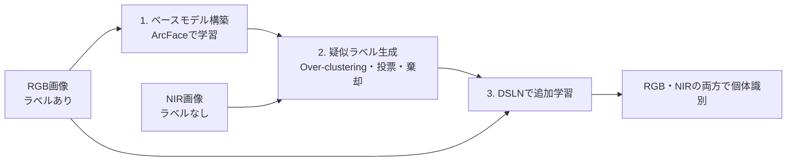

# NIR画像のラベルなし乳牛個体識別(DSLN + 疑似ラベル)

## 概要

夜間の近赤外(NIR)画像での乳牛個体識別のTop-1精度を、NIR画像への人手のラベル付けなしで0.850から0.902に改善しました。
ラベル付きの昼間RGB画像で学習したモデルを、疑似ラベルとドメイン特化正規化層(DSLN)によってNIR画像に適応させる手法です。
学部研究のコードから、手法の中核部分を抜粋して整理したものです。



## 背景

研究の出発点は、帯広畜産大学の牛舎を訪問し、24時間モニタリングの重要性と人力監視の欠点を聞いたことです。夜間の牛舎は消灯されるため、24時間の個体モニタリングにはNIRカメラの画像での識別が必要です。

難しさは2つあります。

- NIR画像には色の情報がなく、輝度分布やテクスチャもRGB画像と大きく異なるため、RGB画像で学習したモデルをそのまま使うと精度が下がる
- NIR画像は暗くぼやけて見づらく、人手でのラベル付けの負担が大きい

データには、帯広畜産大学から提供された牛舎カメラの画像を使いました。

| 用途 | 枚数 | 個体数 |
|---|---|---|
| RGB(学習) | 27,255 | 85 |
| RGB(評価) | 70,060 | 36 |
| NIR(疑似ラベル生成・検証・評価) | 81,414 | 33 |

## 手法

学習は図の3段階です。このリポジトリには2と3を収めています。1のベースモデルは、MegaDescriptor事前学習重みのSwin TransformerをRGB画像でファインチューニングしたものです(本リポジトリには含まない)。

### DSLN(Domain-Specific LayerNorm)

Swin Transformerの全LayerNormを、RGB用とNIR用のアフィン変換パラメータを別々に持つ層へ置換します。Self-AttentionとMLPの重みは両ドメインで共有します。

| 処理 | 場所 |
|---|---|
| DSLN層 | `nir_cattle_id/dsln.py` の `DSLN` |
| 全LayerNormの置換(元の重みを両ドメインへコピー) | `nir_cattle_id/dsln.py` の `convert_to_dsln` |
| ドメインの一括切り替え | `nir_cattle_id/dsln.py` の `set_model_domain` |
| Swinへの組み込みと凍結設定 | `nir_cattle_id/model.py` の `build_dsln_swin` |

### 疑似ラベル生成

NIR画像を個体数より多いクラスタに分割し(Over-clustering)、RGBデータベースを参照した投票でクラスタ単位にラベルを決めます。

1. NIR特徴量をK-Meansでクラスタリングする
2. 各NIR画像について、RGBデータベースをk-NN探索(k=1)し、最近傍の個体IDを票とする
3. クラスタごとに多数決を取り、多数派の割合(純度)が閾値未満のクラスタは棄却する

| 処理 | 場所 |
|---|---|
| 全体の流れ | `nir_cattle_id/pseudo_label.py` の `assign_pseudo_labels` |
| k-NN探索(k=1)の票 | `nir_cattle_id/pseudo_label.py` の `nearest_db_labels` |
| クラスタ内投票と純度の計算 | `nir_cattle_id/pseudo_label.py` の `vote_in_clusters` |

### 学習ループ

1ステップでRGBとNIRを1バッチずつ、対応するDSLNに切り替えて流します。ArcFace Lossのクラス重みは両ドメインで共有します。実装は `nir_cattle_id/trainer.py` の `DualDomainTrainer.train_step` です。

## 設計判断

### なぜ正規化層だけを分けたのか

個体識別の手がかりは体の斑紋です。ドメイン適応の代表的な方法には、それぞれ次のリスクがあります。

- 敵対的学習で分布を大域的に揃える: 異なる個体の特徴が混ざり、識別境界が曖昧になる
- GANなどで画像や特徴を生成する: 斑紋の情報が変質する

そこで画像を加工せず、Domain-Specific Batch Normalizationの考え方をSwin TransformerのLayerNormに応用しました。斑紋の形状のようなドメインに依存しない特徴は共有パラメータで学習し、輝度やコントラストといった見た目の差は正規化層で吸収します。モデルをドメインごとに分けないので、RGBのラベルで学んだ識別の知識をNIRにも使えます。

### なぜ個体数より多いクラスタに分けたのか

乳牛は姿勢によって、同じ個体でも見え方が大きく変わります。個体数と同じ数のクラスタでは、この変化を1つのクラスタに収めきれません。クラスタ数を十分に大きくして、各クラスタに異なる個体が混ざることを防ぐ狙いです。

### なぜ閾値で棄却するのか

誤った疑似ラベルは学習に大きく影響します。実際、疑似ラベルのPrecisionが最も低かったDataset 2では、提案手法のNIR精度がDSLNなしの追加学習をわずかに下回りました。そのため投票が割れたクラスタは学習に使いません。ただし閾値を上げるほど使えるデータは減ります。クラスタ数と閾値の組み合わせを比較し、PrecisionとRecallがどちらも高い設定を選びました。

## 結果

NIR画像は、時間の近い画像が学習と評価に混ざらないよう、1時間分を時系列順に評価・検証・疑似ラベル生成用に3:1:2で分割しました。分割開始位置を変えた3パターン(Dataset 1〜3)を用意しています。

### Top-1精度(3データセット×5回平均)

ベースモデルは追加学習をしていないため、3データセットの平均のみです。

| | ベースモデル | 提案手法 |
|---|---|---|
| NIR | 0.850 | 0.902 |
| RGB | 0.932 | 0.949 |

### 疑似ラベルの精度(Dataset 1、K=100、閾値60%)

| Precision | Recall |
|---|---|
| 0.937 | 0.843 |

Precisionは採用した画像のうちラベルが正しい割合、Recallは全画像のうち正しいラベルで採用された割合です。評価には正解ラベルを使いますが、生成処理では使いません。

## 自分が実装した範囲

学習・推論パイプライン全体、モデル構築、疑似ラベル処理、DSLN組み込み、実験・評価を担当しました(個人研究)。

## ディレクトリ構成

```
configs/          疑似ラベル生成と学習の設定(YAML)
nir_cattle_id/
  dsln.py         DSLN層とモデルへの組み込み
  model.py        Swinの構築と凍結設定
  pseudo_label.py 疑似ラベル生成
  data.py         前処理とPKサンプリング
  trainer.py      学習ループと検証
scripts/          疑似ラベル生成と学習の実行スクリプト
tests/            実データなしで動くテスト
```

## テストの実行方法

テストの実行には、実データ、学習済み重み、GPU、ネットワーク接続のいずれも不要です。

```bash
python -m venv .venv
source .venv/bin/activate
pip install -r requirements.txt
pytest
```

テストでは計算量を抑えるため、ランダム初期化した `swin_tiny_patch4_window7_224` を使います。

## 実行方法

設定ファイルのパスを書き換えてから、リポジトリのルートで実行します。データは `<root>/<個体ID>/<画像>` の形式を想定しています。

```bash
python -m scripts.generate_pseudo_labels --config configs/pseudo_label.yaml
python -m scripts.train --config configs/train_dsln.yaml --seed 42
```

## 注意

研究データは提供元との関係で公開していません。学習済み重みも含みません。

## 発表

柴野桜次朗、山本洋太、中村和晃、谷口行信、「ドメイン特化正規化層を用いた乳牛個体識別のNIR画像へのドメイン適応」、画像電子学会 第317回研究会、2026年6月23日(口頭発表)
